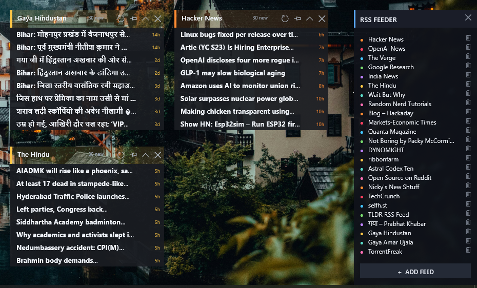
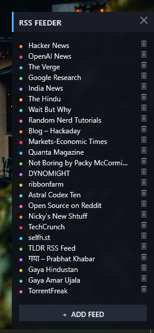

# RSSFeeder for Rainmeter

Minimal dark feed cards for Rainmeter: every RSS/Atom feed gets its own block window
that you can drag anywhere on the desktop. A small manager panel adds / removes feeds.

## Screenshots

Feed cards (with per-feed accent colors, unread badges, mouse-wheel scrolling, tooltips)
and the manager panel listing every subscribed feed:

| Feed cards | Manager |
| --- | --- |
|  |  |

## What's inside

- `RSSFeeder\RSSFeeder.ini` — manager panel (add feed, open blocks, remove)
- `RSSFeeder\Blocks\Block<N>\Block.ini` — one skin **per feed in its own config folder**
  (important: multiple `.ini` files inside one folder would behave as variants of the
  same Rainmeter skin, of which only one can be active at a time)
- `RSSFeeder\@Resources\Common.inc` — shared card layout (edit to restyle every block)
- `RSSFeeder\@Resources\Feeds.inc` — the feed registry (URL, color, rows per feed)
- `RSSFeeder\@Resources\Templates\Block.ini` — template used when generating new blocks
- `RSSFeeder\@Resources\Scripts\*.lua` — manager logic + RSS/Atom parser + shared helpers
- `RSSFeeder\@Resources\State\` — per-block read/unread + collapse state (`B<N>.state`)

Uses only built-in features: WebParser (downloading), Lua (parsing & rendering),
InputText (URL entry). No third-party dependencies.

## Install

```
powershell -ExecutionPolicy Bypass -File install.ps1
```

Detects your Rainmeter `SkinPath` (e.g. `%USERPROFILE%\Documents\Rainmeter\Skins\`),
copies the skin there, regenerates the block configs from the registry and activates
the manager panel. First run seeds `Feeds.inc` from `Feeds.example.inc`; later runs
never overwrite your feed registry or read-state.

Manual install: copy the `RSSFeeder` folder into your Skins folder, refresh Rainmeter
and double-click `RSSFeeder\RSSFeeder.ini` in the Manage window.

## Usage

Manager panel:
- **+ ADD FEED** — paste a feed URL, press **Enter**. The block is generated, activated
  and appears; the accent color cycles through the palette. The feed's own channel
  title replaces the temporary hostname label once the first fetch completes.
- Click a row to open its block card; the `x` removes it (a dimmed row can be re-added).

Block card:
- Drag anywhere; mouse wheel scrolls the item list.
- Click a title to open it in the browser and mark it read (unread = bright, read = dim).
- Header buttons: refresh now · toggle always-on-top · collapse to a pill · close.

## Customize

- All blocks (styles/colors/width/fonts): `@Resources\Common.inc`
- One feed (URL/name/color/rows): edit its row in `Feeds.inc`, then delete
  `Blocks\Block<N>\Block.ini` and click that row in the manager to regenerate.
- Feeds are refetched every ~10 minutes; the refresh button forces an instant fetch.

## Troubleshooting

- **Rainmeter + Lua encoding rule:** all `.lua` files in this skin are saved as
  **UTF-16 LE** (required by Rainmeter for any Unicode strings passed from Lua to
  meters - UTF-8 Lua files render special characters as boxes). If you edit the
  scripts, keep that encoding.
- A card saying *offline / bad url*: the site may block non-browser clients; the
  `UserAgent=` in `Common.inc` can be changed.
- **Sites that time out WebParser** (WinINet can't even connect, e.g. cert or bot
  filtering): add `F<N>Fetch=cmd` for that feed in `@Resources\Feeds.inc`, then
  reinstall. The card switches to `RunCommand` + built-in `curl.exe`
  (Windows 10+) and fetches over curl's TLS stack instead. Requires
  `C:\Windows\System32\curl.exe`.
- **Regenerating cards:** `install.ps1` rebuilds `Blocks\Block*` from the
  registry. Reinstalls never overwrite the live `Feeds.inc` or read-state.
- Cards that were removed from `Feeds.inc` deactivate themselves.
- Unicode titles are supported (files are UTF-8).
- Feed URLs are validated and `#` fragments/wrapping characters are stripped.
- Full removal: unload skins in Manage, delete the `RSSFeeder` folder in your Skins
  path, refresh Rainmeter.
